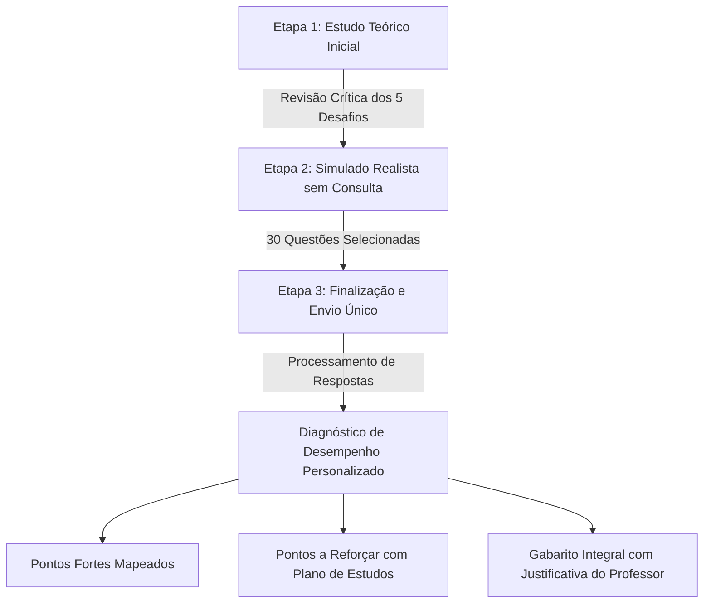

# 🎓 Tópicos Avançados em Sistemas de Informação II
### Plataforma de Aprendizagem Ativa, Guia Teórico & Simulado Avaliativo

[](https://wallace-2105.github.io/Topicos-Avancados-em-Sistemas/)


-brightgreen?style=for-the-badge)


---

> 🌐 **Acesse a aplicação online:** [https://wallace-2105.github.io/Topicos-Avancados-em-Sistemas/](https://wallace-2105.github.io/Topicos-Avancados-em-Sistemas/)
> 
> *Pronto para uso imediato no navegador, sem necessidade de download ou configuração.*

---

## 📖 Visão Geral e Propósito

Este repositório foi concebido como um **Recurso Educacional Aberto (REA)** para apoiar estudantes de graduação em Sistemas de Informação, Ciência da Computação e Engenharia de Software na preparação para exames acadêmicos, certificações e desafios técnicos de mercado.

Diferente de listas estáticas de exercícios, este projeto implementa um **ambiente interativo de aprendizagem ativa** com:
1. **Revisão Conceitual Profunda** dos temas com maior índice de reprovação em provas.
2. **Simulação Realista de Exame** com 30 questões calibradas taxonomicamente (Fácil, Médio e Difícil).
3. **Motor de Diagnóstico Pedagógico** pós-envio que mapeia com precisão cirúrgica seus **pontos fortes** e **pontos que exigem revisão prioritária**.

---

## 🎯 Ementa e Eixos Temáticos Abordados

O conteúdo cobre as interseções críticas entre **Arquitetura de Sistemas**, **Operações Modernas** e **Desenvolvimento Centrado no Usuário**:

### 1. ⚙️ Cultura, Práticas e Engenharia DevOps
* **Cultura DevOps & CAMS:** Colaboração, automação, mensuração e compartilhamento; eliminação de silos entre desenvolvimento e infraestrutura.
* **Pipelines de CI/CD:** Diferença essencial entre *Continuous Integration*, *Continuous Delivery* e *Continuous Deployment*; estágios de esteira (*Lint*, *SAST*, *Testes Unitários*, *Integração*, *Staging*, *Produção*).
* **Infraestrutura como Código (IaC):** Idempotência, prevenção de *Configuration Drift*, versionamento declarativo; sinergia entre **Terraform** (provisionamento) e **Ansible** (gerenciamento de configuração).
* **Conteinerização & Orquestração:** Arquitetura de contêineres (*Docker*, cgroups, namespaces) vs. Máquinas Virtuais; unidades computacionais do **Kubernetes** (*Pods*, *Deployments*, *Services*) e estratégias de release (*Canary*, *Blue/Green*).
* **Observabilidade & Confiabilidade:** O tripé de telemetria (**Métricas**, **Logs** e **Distributed Tracing**); indicadores orientados a valor (**SLI**, **SLO**, **SLA** e *Error Budget*); métricas de performance **DORA**.

### 2. 💡 Design Thinking na Prática (Inovação Centrada no Ser Humano)
* **O Tripé da Inovação:** Interseção harmônica entre **Desejabilidade** (pessoas), **Factibilidade** (tecnologia) e **Viabilidade** (negócio).
* **Os Três Pilares:** **Empatia** (compreensão profunda da dor alheia), **Colaboração** (co-criação multidisciplinar) e **Experimentação** (aprender rápido e barato).
* **O Modelo do Duplo Diamante:**
  * *Diamante 1 (O Problema):* **Imersão** (divergência exploratória, *Shadowing*, entrevistas) vs. **Síntese** (convergência analítica, *Personas*, *Mapa de Empatia*, declaração de problema *"Como Poderíamos..."*).
  * *Diamante 2 (A Solução):* **Ideação** (geração aberta de alternativas) e **Prototipação/Teste** (validação empírica).
* **Matriz CSD:** Dinâmica de alinhamento visual de **Certezas**, **Suposições** e **Dúvidas** para direcionamento de pesquisas de campo.
* **Estratégias de Prototipação:** Diferenças de custo, tempo, fidelidade e apego emocional entre protótipos de **Baixa Fidelidade** (papel/wireframes) e **Alta Fidelidade** (interativos/Figma/código).

### 3. 🛡️ Qualidade de Software, Governança e Métodos Ágeis
* **Scrum na Prática:** Papéis (*Product Owner*, *Scrum Master*, *Developers*), eventos (*Sprint Planning*, *Daily*, *Review*, *Retrospective*) e artefatos.
* **Governança de TI com ITIL 4:** Gerenciamento de Serviços de TI (*ITSM*); compatibilidade entre governança e agilidade através da classificação de **Mudanças Padrão** (*Standard Changes* pré-aprovadas por pipelines automatizados) vs. **Mudanças Normais** sujeitas ao *CAB*.
* **Cultura de Resiliência:** *Post-Mortem Sem Culpa* (*Blameless Post-Mortem*) integrando empatia sistêmica e engenharia de confiabilidade.

---

## 🧭 Metodologia Pedagógica da Aplicação

A aplicação foi desenhada seguindo princípios de **Recuperação Ativa de Memória (Active Recall)** e **Prática Espaçada**:



1. **Etapa 1 — Preparação Conceitual ("Desmistificando os Desafios"):**
   O estudante inicia revisando os 5 conceitos de maior complexidade teórica antes de ser testado.
2. **Etapa 2 — Simulado Avaliativo (30 Questões):**
   O aluno responde a todo o teste sem a revelação prematura do gabarito, exercitando a retenção real em ambiente de prova.
3. **Etapa 3 — Diagnóstico Pedagógico Pós-Envio:**
   O algoritmo calcula métricas multidimensionais (por nível e por tema), identifica as fraquezas específicas do estudante e libera o gabarito comentado completo de cada questão.

---

## ⚡ Guia Rápido dos Desafios Críticos (Cheat Sheet)

Para consulta rápida antes da avaliação, os conceitos centrais foram sintetizados abaixo:

### 1. CI vs. Continuous Delivery vs. Continuous Deployment
| Etapa | Foco | Onde Para a Automação? | Como Entra em Produção? |
| :--- | :--- | :--- | :--- |
| **CI** | Integrar código e rodar testes rápidos. | Build e Testes unitários aprovados. | Não realiza deploy. |
| **Continuous Delivery** | Deixar o software sempre pronto para release. | Deploy em Staging + Testes de Aceite. | **Gatilho Manual de Negócio** ("Push Button"). |
| **Continuous Deployment** | Velocidade e fluxo contínuo sem atrito humano. | Deploy em Produção automatizado. | **100% Automático** após passar nos testes. |

### 2. Terraform vs. Ansible
* **Terraform (Provisionador Declarativo):** Foca em **O QUE** deve existir na nuvem (VPC, sub-redes, instâncias, clusters). Gerencia o ciclo de vida e estado (`.tfstate`).
* **Ansible (Gerenciador de Configuração):** Foca em **COMO** configurar o sistema operacional (instalar pacotes, configurar Nginx, criar usuários, injetar certificados). Opera via SSH sem agentes instalados (*Agentless*).
* **Na Prática:** O Terraform constrói a infraestrutura base e o Ansible entra nas instâncias provisionadas para configurar os serviços.

### 3. Imersão vs. Síntese no Design Thinking
* **Imersão (Divergência):** Coleta exploratória aberta no mundo real (*Shadowing*, entrevistas em profundidade, vivência empática). **Não tenta resolver o problema**, apenas coleta dados e evidências.
* **Síntese (Convergência):** Processamento do caos de informações coletadas. Identificação de padrões, criação de *Personas*, *Mapas de Empatia* e refinamento do verdadeiro desafio (*"Como Poderíamos...?"*).

### 4. Matriz CSD (Certezas, Suposições e Dúvidas)
* **Certezas:** Fatos comprovados por métricas históricas ou dados documentados irrefutáveis.
* **Suposições:** Hipóteses ou "achismos" que o time acredita serem verdade, mas carecem de validação em campo.
* **Dúvidas:** Perguntas abertas e lacunas explícitas para as quais ninguém tem resposta no momento.
* **Dinâmica:** As *Dúvidas* e *Suposições* viram o roteiro de pesquisa da fase de imersão; conforme o projeto avança, dúvidas viram certezas e suposições são validadas ou descartadas.

### 5. Protótipos de Baixa vs. Alta Fidelidade
| Característica | Baixa Fidelidade (Paper Sketches / Wireframes) | Alta Fidelidade (Figma Clicável / Mockup Funcional) |
| :--- | :--- | :--- |
| **Momento de Uso** | Início da ideação para testar conceitos e fluxos macro. | Final da prototipação para testar usabilidade fina e interações. |
| **Custo & Tempo** | Praticamente zero; feito em minutos ou poucas horas. | Alto; exige dias ou semanas de especialistas em UI/UX. |
| **Apego Emocional** | **Nenhum** (fácil descartar ideias ruins sem remorso). | **Alto** (relutância da equipe em descartar trabalho visual elaborado). |
| **Foco do Usuário** | Foca na **lógica funcional** e aponta falhas estruturais. | Foca em detalhes estéticos (cores, fontes, alinhamentos). |

---

## 📁 Arquitetura e Estrutura do Projeto

O projeto segue rigorosamente o princípio da **Separação de Responsabilidades (SoC - Separation of Concerns)**:

```text
Topicos-Avancados-em-Sistemas/
├── index.html          # Marcação semântica (Guia teórico, 30 questões, painel de diagnóstico)
├── css/
│   └── style.css       # Design System (Variáveis HSL/HEX, tema escuro, componentes, regras de impressão)
├── js/
│   └── script.js       # Motor analítico (Banco de dados de questões, avaliação, cálculo de métricas)
└── README.md           # Documentação técnica e pedagógica de alto nível
```

### Decisões de Design de Software:
* **Zero Dependências Externas (Self-Contained):** Não depende de bibliotecas externas, NPM, CDNs ou frameworks complexos. Funciona offline em qualquer máquina.
* **Compatibilidade Universal:** Roda com perfeição em qualquer navegador via protocolo local (`file:///`) ou servidores web HTTP padrão.
* **Estilos de Impressão (`@media print`):** Permite ao aluno utilizar a função nativa de impressão do navegador (Ctrl + P) para gerar um **PDF formatado do simulado com gabarito**.

---

## 🌐 Acesso Online (Deploy em Produção)

A forma mais rápida de utilizar a plataforma é acessando diretamente a versão publicada no **GitHub Pages**, sem precisar clonar ou instalar nada:

👉 **[Acessar Plataforma Online](https://wallace-2105.github.io/Topicos-Avancados-em-Sistemas/)**

---

## 🚀 Como Executar Localmente

### Método 1: Execução Direta (Sem Instalações)
1. Baixe ou clone este repositório:
   ```bash
   git clone https://github.com/wallace-2105/Topicos-Avancados-em-Sistemas.git
   ```
2. Navegue até a pasta do projeto e dê um **duplo clique** no arquivo `index.html`. Ele abrirá instantaneamente em seu navegador padrão (Google Chrome, Microsoft Edge, Mozilla Firefox, Brave, Safari).

### Método 2: Servidor Local Simples (Python)
Caso queira rodar via servidor local:
```bash
# Na raiz do projeto:
python -m http.server 8080
```
Acesse em: `http://localhost:8080`

### Método 3: Extensão Live Server (VS Code / Antigravity IDE)
* Clique com o botão direito sobre o arquivo `index.html` e selecione **"Open with Live Server"**.

---

## 🤝 Como Contribuir

Este é um projeto acadêmico de código aberto voltado à comunidade estudantil. Contribuições são imensamente bem-vindas:

1. Faça um **Fork** do projeto.
2. Crie uma branch para sua funcionalidade ou correção:
   ```bash
   git checkout -b feature/nova-questao-devops
   ```
3. Commit suas alterações seguindo o padrão semântico:
   ```bash
   git commit -m "feat: adiciona questão sobre Chaos Engineering e SLO"
   ```
4. Envie para o repositório remoto:
   ```bash
   git push origin feature/nova-questao-devops
   ```
5. Abra um **Pull Request**.

---

## 📄 Licença

Este projeto está licenciado sob a **Licença MIT** — sinta-se livre para utilizar, modificar e compartilhar para fins de estudo individual ou em grupos acadêmicos.

---

<div align="center">
  <sub>Desenvolvido com foco na excelência acadêmica e na democratização do ensino de Engenharia de Software e DevOps.</sub>
</div>